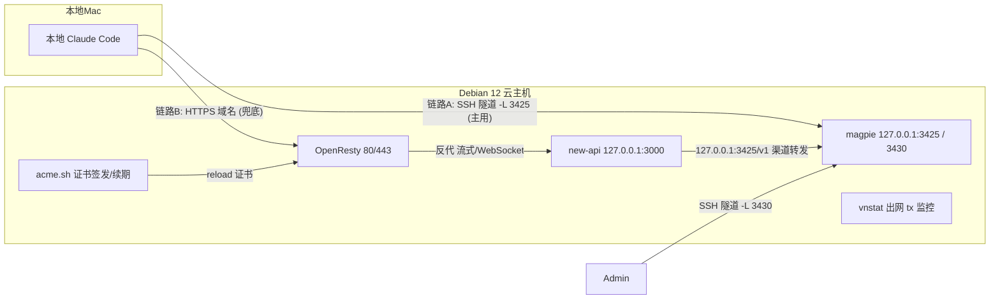

# clouddock 架构说明

clouddock 把一台 Debian 12 云主机锻造成个人 AI 云环境。本文档说明它的架构、目录、部署流程与扩展方式。

## 定位

- **不绑定云厂商**：当前在华为云 Flexus L（新加坡）验证，但脚本面向任何 Debian 12 云主机。
- **一键部署**：`curl | bash` 完成，不依赖本地 OS 与 `rsync`（Windows 也可用）。
- **可扩展**：基础设施与服务分离，加服务 = 加一个目录。

## 系统架构



- **new-api**（3000）：HTTPS 域名对外，Supabase PostgreSQL + Upstash Redis（托管）。
- **magpie**（3425/3430）：内部 LLM 网关，仅绑定 127.0.0.1。
- **OpenResty**（80/443）：反代 + TLS 终结。
- **acme.sh**：Let's Encrypt 证书，独立签发、自动续期。

## 目录结构

```
clouddock/
├── install.sh                       # curl | bash 入口（clone 仓库 + 执行 bootstrap）
├── bootstrap/                       # 部署编排（基础设施，装一次）
│   ├── lib.sh                       #   公共函数库
│   ├── bootstrap.sh                 #   总控：交互收集 + 生成密钥 + 调度
│   └── steps/                       #   阶段脚本（幂等）
│       ├── 00-prereq.sh             #   系统准备 / vnstat / swap
│       ├── 01-docker.sh             #   Docker CE + Compose Plugin
│       ├── 02-openresty.sh          #   OpenResty 安装 + 基础配置
│       ├── 03-acme.sh               #   acme.sh 安装
│       ├── 04-cert.sh               #   证书签发（HTTP-01 / DNS API）
│       ├── 05-services.sh           #   聚合启动所有服务
│       └── 06-openresty-site.sh     #   启用 HTTPS 反代站点
├── services/                        # 服务定义（每服务一目录）
│   ├── new-api/
│   │   ├── compose.yml              #   new-api 编排
│   │   └── deploy.sh                #   就绪检查
│   └── magpie/
│       ├── compose.yml              #   magpie 编排
│       └── deploy.sh                #   就绪检查 + gateway key
├── deploy/.env.example              # 环境变量模板
├── openresty/                       # 反代配置
│   ├── nginx.conf                   #   OpenResty 主配置
│   └── sites/                       #   站点配置
│       ├── new-api-http.conf        #   HTTP 校验阶段
│       └── new-api-https.conf       #   HTTPS 代理阶段
├── scripts/claude-code-tunnel.sh    # 本地 SSH 隧道（链路 A）
└── docs/                            # 文档
```

## 部署流程

1. 用户 SSH 登录云主机，以 root 执行 `curl -fsSL <raw-install-url> | bash`。
2. `install.sh` 检查依赖（git/curl）、clone 仓库到 `/opt/clouddock`，调用 `bootstrap/bootstrap.sh`。
3. `bootstrap.sh` 交互收集配置（域名、证书方式、连接串、流量额度），生成密钥写入 `deploy/.env`。
4. 依次执行 `bootstrap/steps/00~04`（基础设施），`05`（聚合启动服务），`06`（启用 HTTPS 站点）。
5. 全程幂等：命中「已就绪」即跳过，密钥已生成则保留。

## 技术选型

| 组件 | 选择 | 说明 |
| --- | --- | --- |
| 运行时 | Docker CE + Compose Plugin | 官方 Debian 源 |
| 数据库 | Supabase PostgreSQL | 托管，连接串注入 |
| 缓存 | Upstash Redis | 托管，连接串注入 |
| 反代 | OpenResty | 宿主机 80/443 |
| 证书 | acme.sh + Let's Encrypt | HTTP-01 / DNS API |
| 流量监控 | vnstat | tx 出网口径 |

容器重启策略统一为 `restart: on-failure:3`（最多重启 3 次，避免异常无限重启）。

## 环境变量契约

变量按服务加前缀，部署级配置无前缀：

| 变量 | 用途 | 生成方式 |
| --- | --- | --- |
| `NEWAPI_DOMAIN` | new-api 对外域名 | 交互输入 |
| `NEWAPI_SQL_DSN` | Supabase 连接串 | 交互输入 |
| `NEWAPI_REDIS_CONN_STRING` | Upstash 连接串 | 交互输入（可选） |
| `NEWAPI_SESSION_SECRET` / `NEWAPI_CRYPTO_SECRET` | 认证密钥 | `openssl rand -hex 32` |
| `NEWAPI_TRUSTED_PROXIES` | 反代来源 | 常量 |
| `MAGPIE_WEB_KEY` | Web UI key | `.env` 已有 > `MAGPIE_WEB_KEY` 环境变量 > `openssl rand -hex 16` |
| `MAGPIE_PUBLIC_URL` | 内部网关地址 | 常量 |
| `MAGPIE_GATEWAY_KEY` | 链路 A/B 共用调用凭证 | 部署时生成 |
| `CERT_MODE` / `DNS_PROVIDER` / `TRAFFIC_QUOTA_GB` | 部署级配置 | 交互输入 |

> 敏感值（`.env`、`dnsapi.env`）被 `.gitignore` 忽略，不进 git。

## 双链路数据流

- **链路 A（主用）**：本地 Claude Code `ANTHROPIC_BASE_URL=http://127.0.0.1:3425`（SSH 隧道）→ magpie 订阅池路由上游，携带 `MAGPIE_GATEWAY_KEY`。延迟最低、能力完整。
- **链路 B（兜底）**：本地 Claude Code `ANTHROPIC_BASE_URL=https://<NEWAPI_DOMAIN>` → OpenResty → new-api（Anthropic 兼容端点）→ 渠道转发 `127.0.0.1:3425/v1` → magpie → 上游。远程无隧道可用，但为「网关套网关」有两次格式转换，仅兜底。

## 关键设计决策

1. **基础设施与服务分离**：`bootstrap/steps/` 装地基（幂等）；`services/` 放上层应用，可独立增删。
2. **每服务一目录**：`services/<name>/` 自包含 `compose.yml` + `deploy.sh`。
3. **数据库/缓存托管**：本地不跑 PostgreSQL/Redis，省内存、省运维。
4. **magpie 不暴露公网**：仅绑定 127.0.0.1，经 SSH 隧道访问。
5. **下载源铁律**：所有软件与镜像走官方/可信渠道，不配第三方加速。

## 成本与流量管控

华为云 Flexus L（示例）**仅出网流量（tx）计费，入网免费**，含月流量包，超包按量收费。项目通过 `vnstat`（tx 口径）+ 云厂商告警阈值 + 成本自查清单三管齐下，详见 README「成本与流量管控」。

## 扩展指南

新增服务只需在 `services/` 下加一个目录（`compose.yml` + 可选 `deploy.sh`），`05-services.sh` 会自动聚合启动。详见 `docs/add-service.md`。
