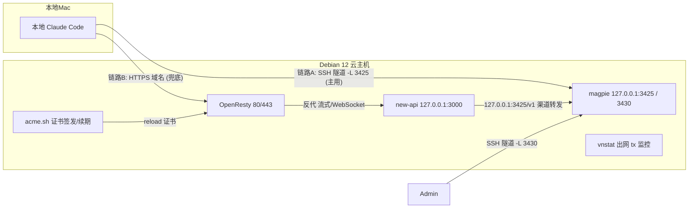

# clouddock — 云主机一键 DIY AI 云环境

## 产品概述

把一台 Debian 12 云主机锻造成个人 AI 云环境：通过 `curl | bash` 一条命令完成系统准备、Docker、HTTPS 网关、new-api 与 magpie 部署，并打通本地 Claude Code 经 magpie 调用的双链路。当前已在华为云 Flexus L（新加坡）验证。项目采用 Apache-2.0 开源，命名 `clouddock`，不绑定特定云厂商。

## 实例事实（验证环境）

- 区域：亚太-新加坡（ap-southeast-3）；系统：Debian 12.0.0 64bit
- 规格：2核 / 2GiB 内存 / 系统盘 40GiB（仅此一块，VBD）/ 流量包 **1024GB/月** / 峰值带宽 30Mbit/s
- 公网 IP 随实例固定绑定；安全组放行 22 / 80 / 443

## 核心功能

- 一键初始化：`curl | bash` 单命令完成 Debian 12 系统准备、Docker 环境安装与基础工具配置，脚本幂等可重复执行，不依赖本地 OS 与 `rsync`（Windows 也可用）。
- new-api 部署：以 HTTPS 域名对外访问（acme.sh + OpenResty），支持流式响应与 WebSocket；数据库走 Supabase PostgreSQL，缓存走 Upstash Redis。
- magpie 部署：内部 LLM 网关，仅绑定 127.0.0.1，不暴露公网，保存订阅与网关配置。
- 本地 Claude Code 双链路接入：① SSH 隧道直连 magpie（主用）；② 经 new-api HTTPS Anthropic 兼容端点转发 magpie（兜底）。
- 可扩展性：基础设施与服务分离，新增服务 = 在 `services/` 下加一个目录。

## 成本与流量风险管控（一等关注点）

### 计费规则（以华为云 Flexus L 为例，已查证官方文档）

- **仅出网流量（tx）计费，入网（rx）免费**；流量包即「出网流量包」。其他云厂商计费口径以各自文档为准。
- 华为云 Flexus L 含 **1024GB/月流量包**，按月重置、清零不累计；超包后出网流量按量计费。
- magpie 中转场景的计费流量 ≈「发给上游模型的请求」+「返回本地的响应」之和（两段均为出网）。
- 1024GB/月对个人重度使用余量充足，但必须可观测。

### 落地措施

1. **流量监控**：`00-prereq.sh` 安装 `vnstat`，对账只看 tx（出网）。
2. **告警阈值**：收尾打印按额度计算的 70% / 90% 阈值，在云厂商控制台配置。
3. **硬边界**：不启用对象存储、日志服务、短信、按量快照等增值计费项。

## 非目标

- 不额外付费：仅使用已购实例与免费证书，不引入按量计费组件，并避免出网流量超包。
- 暂不考虑 Debian 12 以外的系统。

## 软件下载源约束（铁律）

| 组件 | 下载渠道 |
| --- | --- |
| Docker CE + Compose Plugin | Docker 官方 apt 源 `https://download.docker.com/linux/debian` |
| OpenResty | OpenResty 官方 apt 源 `https://openresty.org/package/debian` |
| acme.sh | 官方安装脚本 `https://get.acme.sh` |
| new-api 镜像 | Docker Hub 官方 `calciumion/new-api` |
| magpie 镜像 | `ghcr.io/yetone/magpie` |
| 系统包 | Debian 官方 apt 源 |

## 技术选型

- 编排语言：Bash；入口 `install.sh`（curl | bash，clone 仓库后调用 `bootstrap/bootstrap.sh`）。
- 容器运行时：Docker CE + Compose Plugin；new-api 与 magpie 两个容器，`restart: on-failure:3`（最多重启 3 次）。
- 反向代理：OpenResty（宿主机 80/443）+ acme.sh（Let's Encrypt，HTTP-01 / DNS API）。
- new-api：`calciumion/new-api:latest`，端口 3000；**Supabase PostgreSQL + Upstash Redis（托管，连接串注入）**。
- magpie：`ghcr.io/yetone/magpie:latest`，网关 3425 / Web UI 3430，仅绑定 127.0.0.1。
- 流量监控：`vnstat`（tx 口径）。

## 实现方案

### 总体策略

`install.sh`（curl | bash）在 VPS 上 clone 仓库到 `/opt/clouddock`，调用 `bootstrap/bootstrap.sh` 交互收集配置并写入 `deploy/.env`，随后按阶段幂等执行 `bootstrap/steps/` 下脚本；服务通过 `services/*/compose.yml` 聚合启动。

### 关键决策

1. OpenResty 与 acme.sh 宿主机安装，便于 `systemctl reload` 证书续期钩子。
2. 数据库/缓存走托管服务（Supabase + Upstash），本地不部署 PostgreSQL/Redis 容器，降低内存占用与运维成本。
3. magpie 仅绑定 127.0.0.1（3425/3430），经 SSH 隧道访问，避免公网暴露。
4. OpenResty 两阶段配置：签发前仅 80 端口提供 acme challenge；签发后启用 443 反代。
5. 2GiB 内存下默认启用 2GB swap，防止 OOM。
6. 流量风险通过 vnstat（tx）+ 云厂商告警 + 成本自查清单管控。
7. Docker 镜像默认走官方 registry，不配置第三方加速（新加坡直连通常够快）。
8. 服务目录化：`services/<name>/` 自包含 `compose.yml` + `deploy.sh`，`05-services.sh` 自动遍历聚合。
9. 环境变量按服务加前缀：`NEWAPI_*`（域名/密钥/连接串）、`MAGPIE_*`；部署级配置（`CERT_MODE`/`TRAFFIC_QUOTA_GB`/`DNS_PROVIDER`）无前缀。
10. 本地 Claude Code 双链路：SSH 隧道主用 + new-api HTTPS 兜底（网关套网关，仅兜底）。

### 系统架构



### 数据流

- 链路 A（主用）：本地 Claude Code `ANTHROPIC_BASE_URL=http://127.0.0.1:3425`（SSH 隧道）→ magpie 订阅池路由上游，携带 gateway key。
- 链路 B（兜底）：本地 Claude Code `ANTHROPIC_BASE_URL=https://<NEWAPI_DOMAIN>` → OpenResty 443 → new-api（Anthropic 兼容端点）→ 渠道转发 `127.0.0.1:3425/v1` → magpie → 上游。
- HTTPS 控制台：浏览器 → OpenResty 443 → `127.0.0.1:3000` new-api。
- 证书：acme.sh 通过 webroot（HTTP-01）或 DNS API 签发，续期 `systemctl reload openresty`。

## 实现细节

### 目录结构

```
clouddock/
├── install.sh                       # curl | bash 入口（clone 仓库 + 执行 bootstrap）
├── README.md / LICENSE / .gitignore
├── bootstrap/                       # 部署编排（基础设施，装一次）
│   ├── lib.sh                       #   公共函数库
│   ├── bootstrap.sh                 #   总控：交互收集 + 生成密钥 + 调度
│   └── steps/                       #   阶段脚本（幂等）
│       ├── 00-prereq.sh             #   系统准备 / vnstat / swap
│       ├── 01-docker.sh             #   Docker CE + Compose Plugin
│       ├── 02-openresty.sh          #   OpenResty 安装 + 基础配置
│       ├── 03-acme.sh               #   acme.sh 安装
│       ├── 04-cert.sh               #   证书签发（HTTP-01 / DNS API）
│       ├── 05-services.sh           #   聚合启动所有服务
│       └── 06-openresty-site.sh     #   启用 HTTPS 反代站点
├── services/                        # 服务定义（每服务一目录）
│   ├── new-api/
│   │   ├── compose.yml              #   new-api 编排（Supabase + Upstash）
│   │   └── deploy.sh                #   就绪检查
│   └── magpie/
│       ├── compose.yml              #   magpie 编排
│       └── deploy.sh                #   就绪检查 + gateway key
├── deploy/
│   └── .env.example                 # 环境变量模板
├── openresty/                       # 反代配置
│   ├── nginx.conf                   #   OpenResty 主配置
│   └── sites/                       #   站点配置
│       ├── new-api-http.conf        #   HTTP 校验阶段
│       └── new-api-https.conf       #   HTTPS 代理阶段
├── scripts/
│   └── claude-code-tunnel.sh        # 本地 SSH 隧道（链路 A）
└── docs/
    ├── claude-code-local.md         # 本地 Claude Code 双链路接入
    └── add-service.md               # 新增服务指南
```

### 关键配置契约（环境变量）

| 变量 | 用途 | 生成方式 |
| --- | --- | --- |
| `NEWAPI_DOMAIN` | new-api 对外域名 | 交互输入 |
| `NEWAPI_SQL_DSN` | Supabase PostgreSQL 连接串 | 交互输入 |
| `NEWAPI_REDIS_CONN_STRING` | Upstash Redis 连接串 | 交互输入（可选） |
| `NEWAPI_SESSION_SECRET` / `NEWAPI_CRYPTO_SECRET` | new-api 认证密钥 | `openssl rand -hex 32` |
| `NEWAPI_TRUSTED_PROXIES` | 反代来源 | 常量 |
| `MAGPIE_WEB_KEY` | magpie Web UI 固定 key | `openssl rand -hex 16` |
| `MAGPIE_PUBLIC_URL` | 内部网关地址 | `http://127.0.0.1:3425` |
| `MAGPIE_GATEWAY_KEY` | gateway key（链路 A/B 共用） | `magpie gateway-key add` 生成 |
| `CERT_MODE` / `DNS_PROVIDER` / `TRAFFIC_QUOTA_GB` | 部署级配置（证书方式 / 流量额度） | 交互输入 |

### 实施注意

- 幂等性：各阶段脚本探测「是否已完成」，命中即跳过；密钥已生成则保留不覆盖。
- 低内存（2GiB）：OpenResty 单 worker；不装本地 PostgreSQL/Redis；默认 2GB swap。
- 安全边界：magpie 3425/3430 只绑定 127.0.0.1；公网仅开放 22/80/443；`.env`/`dnsapi.env` 不进 git。
- 证书默认 HTTP-01（需 80/443 放行），检测不可达时提示改用 DNS API。
- 流式与 WebSocket：OpenResty 反代 new-api 关闭缓冲并升级 WebSocket。
- 下载源：所有 apt 源、脚本、镜像均锁定官方/可信渠道。
- Docker 重启策略：`on-failure:3`，避免异常无限重启。

### 复杂度与可靠性

- 安装为线性阶段流程，各阶段 O(1) 幂等检查；Compose 依赖容器 HEALTHCHECK 判断就绪。
- 主要风险在证书签发（80 端口可达性、DNS 生效），通过两阶段 OpenResty 配置隔离，失败可重跑。
- 链路 B 依赖 new-api 与 magpie 协议兼容，作为兜底单独验证，不影响主链路 A。
